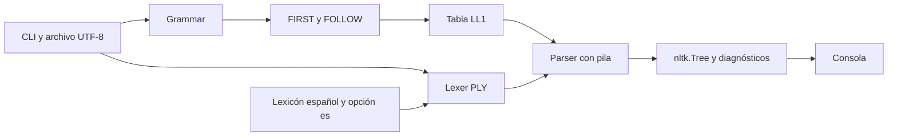

# Auditoría actualizada del Proyecto TLP02-2026

Fecha de evaluación **5 de noviembre de 2026**, zona America/El_Salvador. Repositorio inspeccionado en `C:/Users/Cristopher-Diaz-TDW/Desktop/PROJECTS/TLP-PROYECTO`. Revisión **c2dcd47f3d173a148cf3ecc9d9c2a68c13983bc3**. La comparación de cambios utiliza **7936cabb9ec146746215b5674867f1e16ce2bf1e** como revisión anterior.

La fuente normativa es el archivo oficial facilitado por el usuario. El README actual se contrasta como documentación de la implementación. Los requisitos del documento se tratan como criterios de evaluación. [Especificación oficial](C:/Users/Cristopher-Diaz-TDW/Downloads/especificaci_n_de_proyecto_tlp02_2026.md:19)

## 1. Resumen Ejecutivo

**Avance y cumplimiento verificable en el repositorio frente a ambas fases: 43,04%.**

| Alcance | Cumplimiento ponderado | Estado comprobado |
|---|---:|---|
| Fase 1 | **66,67%** | Parser formal y extensión al español funcionales. Faltan demo NLP independiente, registro sistemático de fallos, análisis formal y el informe exigido. |
| Fase 2 | **27,29%** | Se reutilizan gramática, concordancia, vocabulario y árboles. Faltan mínimos SVO y dos tiempos, corpus suficiente y el conjunto de experimentos NLP/LLM. |
| Proyecto observable, 40% Fase 1 + 60% Fase 2 | **43,04%** | Motor implementado con avance claro en español y entregables experimentales pendientes. |

Se extrajeron **44 requisitos verificables en el repositorio**. Hay **12 cumplidos, 12 parciales y 20 pendientes**. Dentro de los parciales, 9 son funcionales con brechas y 3 tienen soporte inicial. Los informes se califican por su presencia en el árbol inspeccionado. Una entrega que exista fuera del repositorio requiere evidencia adicional para actualizar esas filas.

La cifra anterior de **83,21%** correspondía al README de MiniC. La cifra de esta revisión utiliza las dos fases del documento oficial, incluyendo experimentos y documentos exigidos. La diferencia de alcance explica que el nuevo porcentaje sea menor pese al avance funcional en español.

### Metodología y cálculo

Se revisaron archivos de producto, gramática, lexicón, CLI, runner, fixtures, dependencias, historial Git y documentación. Se ejecutaron las dos suites originales, cobertura conjunta, las 90 sondas de la auditoría anterior y 199 sondas nuevas del español.

La escala aplicada sigue los criterios solicitados en la auditoría inicial.

| Intervalo | Interpretación |
|---|---|
| 0% | Capacidad ausente o entregable no localizado en el repositorio. |
| 1–50% | Soporte inicial, estructura parcial o funcionalidad insuficiente para el requisito. |
| 51–85% | Implementación funcional con brechas, falta de pruebas específicas o contrato incompleto. |
| 86–100% | Funcionalidad operativa con validación y casos de prueba asociados dentro del alcance evaluado. |

El peso interno de cada requisito refleja criticidad técnica y experimental. Se asigna 5 a garantías críticas, 4 a capacidades centrales, 3 a funciones y resultados experimentales, y 2 a soporte. Estos pesos son una decisión del auditor y se muestran por fila. Para combinar fases se usa la distribución 40%/60% del documento oficial. El resultado expresa avance de los artefactos observables y no calcula la calificación del docente.

```text
Fase 1 = Σ(peso × cumplimiento) / Σ(peso) = 3.800 / 57 = 66,6667%
Fase 2 = Σ(peso × cumplimiento) / Σ(peso) = 2.620 / 96 = 27,2917%
Global = 0,40 × 66,6667 + 0,60 × 27,2917 = 43,0417% → 43,04%
```

El desglose y las fórmulas quedan guardados en un archivo estructurado. [auditoria/2026-11-05/matriz_cumplimiento.json](C:/Users/Cristopher-Diaz-TDW/Desktop/PROJECTS/TLP-PROYECTO/auditoria/2026-11-05/matriz_cumplimiento.json)

Las presentaciones de 15–20 minutos, la exposición en vivo, conformación/asistencia del grupo, entrega institucional y capacidad de defensa de cada integrante requieren comprobación externa. Se registran como pendientes de verificación y quedan fuera del denominador técnico.

### Cambios comprobados desde la revisión anterior

| Elemento | Revisión anterior | Revisión actual |
|---|---|---|
| Lenguaje analizado | MiniC | MiniC y español mediante gramática unificada. |
| Selección léxica | Léxico MiniC | `spanish=True` en parser y `--es` en CLI. |
| Lexicón español | Ausente | 161 palabras distribuidas en 19 categorías. |
| No terminales / alternativas / celdas LL(1) | 22 / 44 / 82 | **53 / 102 / 177**. |
| Fixtures MiniC | 20 | **20**, todos pasan. |
| Fixtures de español | Ausentes | **19**, todos pasan, 11 válidos y 8 inválidos. |
| Corpus original total | 20 casos MiniC | **39 casos**, sumando ambos lenguajes. |
| Pruebas CLI originales | Ausentes | Continúan ausentes. La auditoría ejecutó CLI por subprocess. |
| Comparador NLP y experimento LLM | Ausentes | Continúan ausentes. |
| Sondas previas incumplidas | 19 de 90 | **19 de 90**, mismos identificadores y causas. |
| Cobertura de líneas del producto | 78,72% | **80,38%**, ambas suites originales juntas. |

El cambio es sustantivo. Las producciones de español consumen tokens con rasgos morfológicos, generan árboles y rechazan combinaciones incompatibles. El commit modifica 27 archivos e incorpora el lexicón y los 19 fixtures del español.

### Arquitectura, stack y contratos

La aplicación mantiene una arquitectura **CLI modular de un proceso**, con fases de carga de gramática, tokenización, parsing predictivo y presentación. PLY realiza el análisis léxico y NLTK aporta `Tree` y su salida textual. La gramática unificada y el parser siguen acoplados al alfabeto de tokens del lexer.



| Contrato | Comportamiento auditado |
|---|---|
| `Grammar(path)` | Carga reglas y calcula conjuntos y tabla. Valida tokens contra `lexer.tokens`. Rechaza conflictos con celda identificada. |
| `tokenize(source, spanish=False)` | Retorna tokens con tipo, lexema, línea y columna. Cambia la clasificación de palabras al activar español. Errores léxicos conservan solo línea y carácter. |
| `parse(source, grammar, spanish=False)` | Retorna árbol y lista de mensajes. El modo léxico no restringe la alternativa inicial de la gramática. |
| CLI | Soporta fuente, `--es`, `--compacto`, `--tabla` y `-g/--gramatica`. |
| Datos | Producciones, conjuntos de símbolos, tabla, tuplas de tokens, lexicón y fixtures locales. |
| Dependencias | `ply==3.11`, `nltk==3.10.4`. Entorno auditado con Python 3.14.8 y Coverage 7.17.1. |
| Salud del entorno | `pip check` finaliza correctamente. Se reutilizó el entorno presente en el repositorio. |
| Integraciones externas | El producto usa bibliotecas locales. Los clientes y adaptadores de NLP/LLM exigidos para los experimentos siguen por desarrollar. |

La especificación plantea procesamiento local y experimentos. No define endpoints HTTP, entidades de base de datos o persistencia transaccional, por lo que esos elementos quedan fuera de la matriz.

### Riesgos principales para el cierre

El riesgo de Fase 1 se concentra en la demo comparativa y la justificación formal de los resultados. El riesgo de Fase 2 se concentra en la infraestructura experimental, el corpus y las métricas, además de los dos mínimos de gramática pendientes. La suite actual acredita ejemplos del subconjunto implementado, pero todavía no acredita el conjunto de entregables del proyecto.

## 2. Matriz de Cumplimiento de Requisitos

Los IDs son nuevos para esta matriz y distinguen las fases oficiales. Las referencias Lxx apuntan a líneas de la especificación. Las capacidades compartidas aparecen en ambas fases porque forman parte de las obligaciones de cada una.

### Fase 1

| ID | Requerimiento / Feature y origen | Peso | Archivos de código / evidencia | Estado | Cumplimiento | Evidencia técnica / faltantes |
|---|---|---:|---|---|---:|---|
| F1-REQ-01 | Parser formal Python LL(1) del subconjunto MiniC. [L44](C:/Users/Cristopher-Diaz-TDW/Downloads/especificaci_n_de_proyecto_tlp02_2026.md:44) | 5 | [minic/parser.py:8](C:/Users/Cristopher-Diaz-TDW/Desktop/PROJECTS/TLP-PROYECTO/minic/parser.py:8); [minic/grammar.py:70](C:/Users/Cristopher-Diaz-TDW/Desktop/PROJECTS/TLP-PROYECTO/minic/grammar.py:70); [gramatica_minic.txt:11](C:/Users/Cristopher-Diaz-TDW/Desktop/PROJECTS/TLP-PROYECTO/gramatica_minic.txt:11) | Cumplido | 90% | Motor predictivo real con pila y tabla; 20/20 fixtures pasan. Persisten diferencias del léxico frente a C y límites de entrada. |
| F1-REQ-02 | Árbol de análisis sintáctico del lenguaje formal. [L44](C:/Users/Cristopher-Diaz-TDW/Downloads/especificaci_n_de_proyecto_tlp02_2026.md:44) | 3 | [minic/parser.py:21](C:/Users/Cristopher-Diaz-TDW/Desktop/PROJECTS/TLP-PROYECTO/minic/parser.py:21); [main.py:50](C:/Users/Cristopher-Diaz-TDW/Desktop/PROJECTS/TLP-PROYECTO/main.py:50) | Parcial / funcional | 85% | nltk.Tree real y representación textual funcional. El runner descarta el árbol; fuentes válidas extensas fallan al imprimir. |
| F1-REQ-03 | Manejo básico de errores sintácticos. [L44](C:/Users/Cristopher-Diaz-TDW/Downloads/especificaci_n_de_proyecto_tlp02_2026.md:44) | 3 | [minic/parser.py:40](C:/Users/Cristopher-Diaz-TDW/Desktop/PROJECTS/TLP-PROYECTO/minic/parser.py:40); [minic/parser.py:53](C:/Users/Cristopher-Diaz-TDW/Desktop/PROJECTS/TLP-PROYECTO/minic/parser.py:53) | Parcial / funcional | 75% | Recuperación por FOLLOW e inserción de terminales. Línea/columna sintáctica presentes; orden mixto de diagnósticos y manejo de excepciones pendientes. |
| F1-REQ-04 | Pruebas de entradas válidas e inválidas de MiniC. [L45](C:/Users/Cristopher-Diaz-TDW/Downloads/especificaci_n_de_proyecto_tlp02_2026.md:45) | 4 | [tests/run_tests.py:51](C:/Users/Cristopher-Diaz-TDW/Desktop/PROJECTS/TLP-PROYECTO/tests/run_tests.py:51); [tests/validos/v01_declaraciones.c:1](C:/Users/Cristopher-Diaz-TDW/Desktop/PROJECTS/TLP-PROYECTO/tests/validos/v01_declaraciones.c:1); [tests/invalidos/i01_falta_punto_y_coma.c:1](C:/Users/Cristopher-Diaz-TDW/Desktop/PROJECTS/TLP-PROYECTO/tests/invalidos/i01_falta_punto_y_coma.c:1) | Cumplido | 95% | 9 válidos y 11 inválidos ejecutados correctamente. Los negativos comprueban primera línea del error. |
| F1-REQ-05 | Extensión de la CFG del parser al español. [L46](C:/Users/Cristopher-Diaz-TDW/Downloads/especificaci_n_de_proyecto_tlp02_2026.md:46) | 4 | [gramatica_minic.txt:11](C:/Users/Cristopher-Diaz-TDW/Desktop/PROJECTS/TLP-PROYECTO/gramatica_minic.txt:11); [minic/parser.py:18](C:/Users/Cristopher-Diaz-TDW/Desktop/PROJECTS/TLP-PROYECTO/minic/parser.py:18); [minic/lexer.py:45](C:/Users/Cristopher-Diaz-TDW/Desktop/PROJECTS/TLP-PROYECTO/minic/lexer.py:45) | Cumplido | 95% | Una gramática unificada y selección de lexicón por spanish/--es; 19/19 fixtures del español pasan. |
| F1-REQ-06 | Concordancia de género y número sustantivo-adjetivo. [L46](C:/Users/Cristopher-Diaz-TDW/Downloads/especificaci_n_de_proyecto_tlp02_2026.md:46) | 4 | [gramatica_minic.txt:55](C:/Users/Cristopher-Diaz-TDW/Desktop/PROJECTS/TLP-PROYECTO/gramatica_minic.txt:55); [minic/lexicon_es.py:43](C:/Users/Cristopher-Diaz-TDW/Desktop/PROJECTS/TLP-PROYECTO/minic/lexicon_es.py:43) | Cumplido | 95% | Categorías MS/FS/MP/FP y negativos de concordancia. Barrido adicional de 128 combinaciones nominales/verbales correcto. |
| F1-REQ-07 | Concordancia entre sujeto y verbo. [L46](C:/Users/Cristopher-Diaz-TDW/Downloads/especificaci_n_de_proyecto_tlp02_2026.md:46) | 4 | [gramatica_minic.txt:50](C:/Users/Cristopher-Diaz-TDW/Desktop/PROJECTS/TLP-PROYECTO/gramatica_minic.txt:50); [gramatica_minic.txt:72](C:/Users/Cristopher-Diaz-TDW/Desktop/PROJECTS/TLP-PROYECTO/gramatica_minic.txt:72) | Cumplido | 95% | Tercera persona singular/plural en SV; negativos originales y barrido adicional detectan combinaciones incompatibles. |
| F1-REQ-08 | Al menos un tipo de cláusula subordinada. [L46](C:/Users/Cristopher-Diaz-TDW/Downloads/especificaci_n_de_proyecto_tlp02_2026.md:46) | 4 | [gramatica_minic.txt:78](C:/Users/Cristopher-Diaz-TDW/Desktop/PROJECTS/TLP-PROYECTO/gramatica_minic.txt:78); [tests/es/validos/v07_subordinada.txt:1](C:/Users/Cristopher-Diaz-TDW/Desktop/PROJECTS/TLP-PROYECTO/tests/es/validos/v07_subordinada.txt:1) | Cumplido | 95% | Complemento con que y Oracion recursiva real. Sonda con dos niveles de subordinación aceptada y tres nodos Oracion. |
| F1-REQ-09 | Modificadores adjetivales. [L46](C:/Users/Cristopher-Diaz-TDW/Downloads/especificaci_n_de_proyecto_tlp02_2026.md:46) | 2 | [gramatica_minic.txt:62](C:/Users/Cristopher-Diaz-TDW/Desktop/PROJECTS/TLP-PROYECTO/gramatica_minic.txt:62); [tests/es/validos/v05_modificadores.txt:1](C:/Users/Cristopher-Diaz-TDW/Desktop/PROJECTS/TLP-PROYECTO/tests/es/validos/v05_modificadores.txt:1) | Cumplido | 95% | Adjetivos pospuestos concordados y atributos tras cópula; tests positivos y negativos asociados. |
| F1-REQ-10 | Modificadores adverbiales. [L46](C:/Users/Cristopher-Diaz-TDW/Downloads/especificaci_n_de_proyecto_tlp02_2026.md:46) | 2 | [gramatica_minic.txt:95](C:/Users/Cristopher-Diaz-TDW/Desktop/PROJECTS/TLP-PROYECTO/gramatica_minic.txt:95); [minic/lexicon_es.py:111](C:/Users/Cristopher-Diaz-TDW/Desktop/PROJECTS/TLP-PROYECTO/minic/lexicon_es.py:111) | Cumplido | 95% | ADV antes/después de PP en modificadores verbales; fixtures v05/v09 y sondas correctos. |
| F1-REQ-11 | Modificadores con frases preposicionales. [L46](C:/Users/Cristopher-Diaz-TDW/Downloads/especificaci_n_de_proyecto_tlp02_2026.md:46) | 3 | [gramatica_minic.txt:68](C:/Users/Cristopher-Diaz-TDW/Desktop/PROJECTS/TLP-PROYECTO/gramatica_minic.txt:68); [gramatica_minic.txt:95](C:/Users/Cristopher-Diaz-TDW/Desktop/PROJECTS/TLP-PROYECTO/gramatica_minic.txt:95) | Cumplido | 90% | PP -> PREP SN funciona en posiciones verbales. v06 acepta dos PP sucesivas pero su árbol no contiene PP dentro del SN. |
| F1-REQ-12 | Registro sistemático de fallos con regla y fenómeno. [L47](C:/Users/Cristopher-Diaz-TDW/Downloads/especificaci_n_de_proyecto_tlp02_2026.md:47) | 5 | [tests/es/invalidos/i03_genero_adjetivo.txt:1](C:/Users/Cristopher-Diaz-TDW/Desktop/PROJECTS/TLP-PROYECTO/tests/es/invalidos/i03_genero_adjetivo.txt:1); [tests/run_tests.py:58](C:/Users/Cristopher-Diaz-TDW/Desktop/PROJECTS/TLP-PROYECTO/tests/run_tests.py:58); [minic/parser.py:55](C:/Users/Cristopher-Diaz-TDW/Desktop/PROJECTS/TLP-PROYECTO/minic/parser.py:55) | Parcial / esqueleto | 30% | 8 negativos y mensajes con no terminal ofrecen una base; no hay dataset de fenómenos, regla de producción registrada, clasificación ni exportación experimental. |
| F1-REQ-13 | Análisis formal de fallos y relación con Chomsky. [L43](C:/Users/Cristopher-Diaz-TDW/Downloads/especificaci_n_de_proyecto_tlp02_2026.md:43) | 4 | — | Pendiente | 0% | No se encontró análisis teórico propio, clasificación formal ni evidencia de qué límite corresponde al diseño, LL(1) o CFG. |
| F1-REQ-14 | Demo NLP sobre las mismas oraciones del parser. [L48](C:/Users/Cristopher-Diaz-TDW/Downloads/especificaci_n_de_proyecto_tlp02_2026.md:48) | 5 | [minic/parser.py:3](C:/Users/Cristopher-Diaz-TDW/Desktop/PROJECTS/TLP-PROYECTO/minic/parser.py:3) | Pendiente | 0% | NLTK se utiliza para construir árboles propios. No existe un segundo analizador NLP ni script de comparación de oraciones. |
| F1-REQ-15 | Código documentado y README ejecutable. [L52](C:/Users/Cristopher-Diaz-TDW/Downloads/especificaci_n_de_proyecto_tlp02_2026.md:52) | 2 | [README.md:20](C:/Users/Cristopher-Diaz-TDW/Desktop/PROJECTS/TLP-PROYECTO/README.md:20); [minic/lexicon_es.py:1](C:/Users/Cristopher-Diaz-TDW/Desktop/PROJECTS/TLP-PROYECTO/minic/lexicon_es.py:1); [tests/run_tests.py:1](C:/Users/Cristopher-Diaz-TDW/Desktop/PROJECTS/TLP-PROYECTO/tests/run_tests.py:1) | Parcial / funcional | 85% | Comandos MiniC/español y limitaciones documentados y verificados. Falta documentar y reproducir la demo comparativa requerida. |
| F1-REQ-16 | Informe técnico Fase 1 de 5–7 páginas. [L51](C:/Users/Cristopher-Diaz-TDW/Downloads/especificaci_n_de_proyecto_tlp02_2026.md:51) | 3 | — | Pendiente | 0% | No se encontró el informe del proyecto en el árbol inspeccionado. La auditoría previa no acredita este entregable. |
| **F1 TOTAL** | **16 requisitos** | **57** | | | **66,67%** | **Σ(peso × cumplimiento) = 3.800** |

### Fase 2

| ID | Requerimiento / Feature y origen | Peso | Archivos de código / evidencia | Estado | Cumplimiento | Evidencia técnica / faltantes |
|---|---|---:|---|---|---:|---|
| F2-REQ-01 | CFG explícita para un español controlado. [L70](C:/Users/Cristopher-Diaz-TDW/Downloads/especificaci_n_de_proyecto_tlp02_2026.md:70) | 4 | [gramatica_minic.txt:50](C:/Users/Cristopher-Diaz-TDW/Desktop/PROJECTS/TLP-PROYECTO/gramatica_minic.txt:50); [README.md:76](C:/Users/Cristopher-Diaz-TDW/Desktop/PROJECTS/TLP-PROYECTO/README.md:76) | Parcial / funcional | 85% | Producciones y límites explícitos, lexicón finito y tabla sin conflictos. El mínimo SVO y tiempos queda pendiente en requisitos propios. |
| F2-REQ-02 | Oraciones sujeto-verbo-objeto con objeto directo. [L70](C:/Users/Cristopher-Diaz-TDW/Downloads/especificaci_n_de_proyecto_tlp02_2026.md:70) | 5 | [gramatica_minic.txt:72](C:/Users/Cristopher-Diaz-TDW/Desktop/PROJECTS/TLP-PROYECTO/gramatica_minic.txt:72); [gramatica_minic.txt:78](C:/Users/Cristopher-Diaz-TDW/Desktop/PROJECTS/TLP-PROYECTO/gramatica_minic.txt:78) | Pendiente | 0% | No hay producción que consuma SN como objeto. El niño lee el libro y Las niñas compran las flores se rechazan con palabras conocidas. |
| F2-REQ-03 | Modificadores adjetivales. [L70](C:/Users/Cristopher-Diaz-TDW/Downloads/especificaci_n_de_proyecto_tlp02_2026.md:70) | 2 | [gramatica_minic.txt:62](C:/Users/Cristopher-Diaz-TDW/Desktop/PROJECTS/TLP-PROYECTO/gramatica_minic.txt:62); [tests/es/validos/v03_det_sust_adj.txt:1](C:/Users/Cristopher-Diaz-TDW/Desktop/PROJECTS/TLP-PROYECTO/tests/es/validos/v03_det_sust_adj.txt:1) | Cumplido | 95% | Implementación compartida con Fase 1 y casos asociados de concordancia. |
| F2-REQ-04 | Modificadores adverbiales. [L70](C:/Users/Cristopher-Diaz-TDW/Downloads/especificaci_n_de_proyecto_tlp02_2026.md:70) | 2 | [gramatica_minic.txt:95](C:/Users/Cristopher-Diaz-TDW/Desktop/PROJECTS/TLP-PROYECTO/gramatica_minic.txt:95); [tests/es/validos/v09_adverbio_plural.txt:1](C:/Users/Cristopher-Diaz-TDW/Desktop/PROJECTS/TLP-PROYECTO/tests/es/validos/v09_adverbio_plural.txt:1) | Cumplido | 95% | ADV implementado y ejercitado en la suite; combinaciones adicionales con PP pasan. |
| F2-REQ-05 | Modificadores preposicionales. [L70](C:/Users/Cristopher-Diaz-TDW/Downloads/especificaci_n_de_proyecto_tlp02_2026.md:70) | 3 | [gramatica_minic.txt:68](C:/Users/Cristopher-Diaz-TDW/Desktop/PROJECTS/TLP-PROYECTO/gramatica_minic.txt:68); [tests/es/validos/v06_pp_anidada.txt:1](C:/Users/Cristopher-Diaz-TDW/Desktop/PROJECTS/TLP-PROYECTO/tests/es/validos/v06_pp_anidada.txt:1) | Parcial / funcional | 85% | Frases preposicionales operativas. El corpus no verifica semántica de adjunción y el caso llamado anidado construye PP hermanas. |
| F2-REQ-06 | Al menos dos tiempos verbales. [L70](C:/Users/Cristopher-Diaz-TDW/Downloads/especificaci_n_de_proyecto_tlp02_2026.md:70) | 5 | [minic/lexicon_es.py:86](C:/Users/Cristopher-Diaz-TDW/Desktop/PROJECTS/TLP-PROYECTO/minic/lexicon_es.py:86) | Pendiente | 0% | Solo formas de presente. Corrió, corrieron y cantaba se tokenizan como ID y se rechazan. |
| F2-REQ-07 | Concordancia básica. [L70](C:/Users/Cristopher-Diaz-TDW/Downloads/especificaci_n_de_proyecto_tlp02_2026.md:70) | 4 | [gramatica_minic.txt:56](C:/Users/Cristopher-Diaz-TDW/Desktop/PROJECTS/TLP-PROYECTO/gramatica_minic.txt:56); [gramatica_minic.txt:72](C:/Users/Cristopher-Diaz-TDW/Desktop/PROJECTS/TLP-PROYECTO/gramatica_minic.txt:72); [gramatica_minic.txt:84](C:/Users/Cristopher-Diaz-TDW/Desktop/PROJECTS/TLP-PROYECTO/gramatica_minic.txt:84) | Cumplido | 95% | Rasgos finitos en categorías, originales y 160 combinaciones adicionales de concordancia/atributo correctas. |
| F2-REQ-08 | Vocabulario reducido definido y variado. [L70](C:/Users/Cristopher-Diaz-TDW/Downloads/especificaci_n_de_proyecto_tlp02_2026.md:70) | 2 | [minic/lexicon_es.py:43](C:/Users/Cristopher-Diaz-TDW/Desktop/PROJECTS/TLP-PROYECTO/minic/lexicon_es.py:43) | Parcial / funcional | 85% | 161 entradas y 19 categorías. Sustantivos, adjetivos, verbos, cópulas, ADV, PREP y QUE; desconocidos vuelven ID sin diagnóstico léxico específico. |
| F2-REQ-09 | Parser propio LL(1) que valide frases. [L71](C:/Users/Cristopher-Diaz-TDW/Downloads/especificaci_n_de_proyecto_tlp02_2026.md:71) | 5 | [minic/parser.py:8](C:/Users/Cristopher-Diaz-TDW/Desktop/PROJECTS/TLP-PROYECTO/minic/parser.py:8); [minic/lexer.py:80](C:/Users/Cristopher-Diaz-TDW/Desktop/PROJECTS/TLP-PROYECTO/minic/lexer.py:80) | Parcial / funcional | 85% | Opera con 19 fixtures. --es selecciona léxico y mantiene Program unificado: también acepta MiniC y vacío, relevante para evaluar frases. |
| F2-REQ-10 | Árboles sintácticos visuales por oración. [L71](C:/Users/Cristopher-Diaz-TDW/Downloads/especificaci_n_de_proyecto_tlp02_2026.md:71) | 3 | [main.py:50](C:/Users/Cristopher-Diaz-TDW/Desktop/PROJECTS/TLP-PROYECTO/main.py:50); [minic/parser.py:21](C:/Users/Cristopher-Diaz-TDW/Desktop/PROJECTS/TLP-PROYECTO/minic/parser.py:21) | Parcial / funcional | 85% | CLI --es presenta árbol textual con pretty_print; prueba por subprocess exitosa. Sin pruebas originales de CLI o exportación automatizada. |
| F2-REQ-11 | Corpus de al menos 60 oraciones. [L76](C:/Users/Cristopher-Diaz-TDW/Downloads/especificaci_n_de_proyecto_tlp02_2026.md:76) | 4 | [tests/es/validos/v01_sujeto_singular.txt:1](C:/Users/Cristopher-Diaz-TDW/Desktop/PROJECTS/TLP-PROYECTO/tests/es/validos/v01_sujeto_singular.txt:1); [tests/es/invalidos/i01_genero_det_sust.txt:1](C:/Users/Cristopher-Diaz-TDW/Desktop/PROJECTS/TLP-PROYECTO/tests/es/invalidos/i01_genero_det_sust.txt:1) | Parcial / esqueleto | 30% | 19 oraciones originales (11 positivas, 8 negativas), faltan al menos 41. Las combinaciones generadas por el auditor no amplían el corpus entregado. |
| F2-REQ-12 | Corpus organizado en tres niveles de complejidad. [L72](C:/Users/Cristopher-Diaz-TDW/Downloads/especificaci_n_de_proyecto_tlp02_2026.md:72) | 3 | [tests/run_tests.py:41](C:/Users/Cristopher-Diaz-TDW/Desktop/PROJECTS/TLP-PROYECTO/tests/run_tests.py:41) | Pendiente | 0% | Solo carpetas validos/invalidos; no hay niveles simples/intermedios/complejos ni metadatos equivalentes. |
| F2-REQ-13 | Salida esperada etiquetada en el corpus. [L76](C:/Users/Cristopher-Diaz-TDW/Downloads/especificaci_n_de_proyecto_tlp02_2026.md:76) | 3 | [tests/run_tests.py:51](C:/Users/Cristopher-Diaz-TDW/Desktop/PROJECTS/TLP-PROYECTO/tests/run_tests.py:51); [tests/run_tests.py:61](C:/Users/Cristopher-Diaz-TDW/Desktop/PROJECTS/TLP-PROYECTO/tests/run_tests.py:61) | Parcial / funcional | 85% | Aceptación por carpeta y línea esperada en negativos. Faltan etiquetas de fenómenos, estructura/tokens esperados y significado homogéneo para comparar sistemas. |
| F2-REQ-14 | Al menos dos herramientas modernas de NLP. [L77](C:/Users/Cristopher-Diaz-TDW/Downloads/especificaci_n_de_proyecto_tlp02_2026.md:77) | 5 | [requirements.txt:1](C:/Users/Cristopher-Diaz-TDW/Desktop/PROJECTS/TLP-PROYECTO/requirements.txt:1); [minic/parser.py:3](C:/Users/Cristopher-Diaz-TDW/Desktop/PROJECTS/TLP-PROYECTO/minic/parser.py:3) | Pendiente | 0% | No hay adaptadores de NLP. Instalar NLTK y usar Tree no ejecuta un analizador independiente. |
| F2-REQ-15 | Procesar y comparar el mismo conjunto entre sistemas. [L77](C:/Users/Cristopher-Diaz-TDW/Downloads/especificaci_n_de_proyecto_tlp02_2026.md:77) | 4 | — | Pendiente | 0% | No hay orquestador experimental, IDs compartidos de resultados ni contrato de comparación. |
| F2-REQ-16 | Métrica de precisión. [L78](C:/Users/Cristopher-Diaz-TDW/Downloads/especificaci_n_de_proyecto_tlp02_2026.md:78) | 3 | — | Pendiente | 0% | No se calculan TP/FP ni precisión; el porcentaje de fixtures aprobados no implementa esta métrica. |
| F2-REQ-17 | Métrica de cobertura o recall. [L78](C:/Users/Cristopher-Diaz-TDW/Downloads/especificaci_n_de_proyecto_tlp02_2026.md:78) | 3 | — | Pendiente | 0% | No hay TP/FN ni recall por sistema o nivel. |
| F2-REQ-18 | Tasa de rechazo correcto. [L78](C:/Users/Cristopher-Diaz-TDW/Downloads/especificaci_n_de_proyecto_tlp02_2026.md:78) | 3 | — | Pendiente | 0% | No hay TN/(TN+FP) ni metodología para decidir rechazo en herramientas NLP. |
| F2-REQ-19 | Clasificación de falsos positivos, falsos negativos y errores de etiquetado. [L78](C:/Users/Cristopher-Diaz-TDW/Downloads/especificaci_n_de_proyecto_tlp02_2026.md:78) | 3 | [tests/run_tests.py:55](C:/Users/Cristopher-Diaz-TDW/Desktop/PROJECTS/TLP-PROYECTO/tests/run_tests.py:55) | Pendiente | 0% | El runner muestra OK/FALLA, sin clasificación ni exportación por oración/sistema. |
| F2-REQ-20 | Tablas y gráficas de resultados cuantitativos. [L78](C:/Users/Cristopher-Diaz-TDW/Downloads/especificaci_n_de_proyecto_tlp02_2026.md:78) | 3 | [tests/run_tests.py:75](C:/Users/Cristopher-Diaz-TDW/Desktop/PROJECTS/TLP-PROYECTO/tests/run_tests.py:75) | Pendiente | 0% | Existe tabla de pruebas, pero no tablas comparativas de métricas ni generación de gráficas del experimento. |
| F2-REQ-21 | Experimento con LLM mediante API. [L79](C:/Users/Cristopher-Diaz-TDW/Downloads/especificaci_n_de_proyecto_tlp02_2026.md:79) | 5 | — | Pendiente | 0% | No hay cliente, ejecución ni resultados de API LLM. |
| F2-REQ-22 | Prompt con reglas explícitas de producción. [L79](C:/Users/Cristopher-Diaz-TDW/Downloads/especificaci_n_de_proyecto_tlp02_2026.md:79) | 3 | — | Pendiente | 0% | No existen prompts ni inyección versionada de las reglas de la gramática en solicitudes. |
| F2-REQ-23 | Comparación few-shot frente a zero-shot. [L82](C:/Users/Cristopher-Diaz-TDW/Downloads/especificaci_n_de_proyecto_tlp02_2026.md:82) | 4 | — | Pendiente | 0% | No hay variantes de prompt, ejemplos controlados ni ejecuciones comparables. |
| F2-REQ-24 | Evaluar adhesión a reglas y aciertos/fallos del LLM. [L80](C:/Users/Cristopher-Diaz-TDW/Downloads/especificaci_n_de_proyecto_tlp02_2026.md:80) | 4 | — | Pendiente | 0% | No hay validación de derivaciones/árboles generados ni registro de desviaciones hacia gramática general. |
| F2-REQ-25 | Logs de prompts y respuestas obtenidas. [L87](C:/Users/Cristopher-Diaz-TDW/Downloads/especificaci_n_de_proyecto_tlp02_2026.md:87) | 3 | — | Pendiente | 0% | No se encontraron logs reales de experimentos, identificadores de modelo o trazabilidad de respuestas. |
| F2-REQ-26 | Comparación de robustez, ambigüedad, escalabilidad y costo. [L83](C:/Users/Cristopher-Diaz-TDW/Downloads/especificaci_n_de_proyecto_tlp02_2026.md:83) | 3 | — | Pendiente | 0% | No se registran ejecuciones de otros sistemas, tiempos, consumo/costo ni análisis experimental comparable. |
| F2-REQ-27 | Código y README para reproducir los experimentos. [L87](C:/Users/Cristopher-Diaz-TDW/Downloads/especificaci_n_de_proyecto_tlp02_2026.md:87) | 2 | [README.md:20](C:/Users/Cristopher-Diaz-TDW/Desktop/PROJECTS/TLP-PROYECTO/README.md:20) | Parcial / esqueleto | 20% | Se reproduce el parser y sus fixtures. Faltan componentes y comandos de corpus, NLP, métricas y LLM. |
| F2-REQ-28 | Informe final Fase 2 de 7–10 páginas con resultados. [L86](C:/Users/Cristopher-Diaz-TDW/Downloads/especificaci_n_de_proyecto_tlp02_2026.md:86) | 3 | — | Pendiente | 0% | No se encontró informe final en el repositorio ni resultados que lo sustenten. |
| **F2 TOTAL** | **28 requisitos** | **96** | | | **27,29%** | **Σ(peso × cumplimiento) = 2.620** |

### Entregables que requieren evidencia adicional

| Elemento | Evidencia local observada | Tratamiento |
|---|---|---|
| Informe técnico Fase 1, 5–7 páginas | No localizado. | Incluido como pendiente en F1-REQ-16. |
| Informe final Fase 2, 7–10 páginas | No localizado. | Incluido como pendiente en F2-REQ-28. |
| Presentaciones de ambas fases y demos en vivo | No hay material que permita verificar su duración o ejecución ante el docente. | Verificación externa, fuera del cálculo. |
| Repositorio compartido/entrega en E-campus | Hay historial Git local. | Compartición y entrega requieren evidencia externa. |
| Integrantes, asistencia y defensa de código | El campo de integrantes del README está vacío. | Verificación académica externa, fuera del cálculo. |

## 3. Hallazgos Técnicos Clave

### H-01 · Bloqueante para Fase 1 · Falta la demo con un analizador NLP independiente

La especificación requiere procesar las mismas oraciones con la gramática extendida y una biblioteca NLP. Los imports de NLTK encontrados construyen y presentan el árbol del parser propio. No existe un segundo análisis, un adaptador o un script que compare ambos resultados. F1-REQ-14 queda en 0%. [Especificación L48](C:/Users/Cristopher-Diaz-TDW/Downloads/especificaci_n_de_proyecto_tlp02_2026.md:48) [minic/parser.py:3](C:/Users/Cristopher-Diaz-TDW/Desktop/PROJECTS/TLP-PROYECTO/minic/parser.py:3)

Para cerrar este punto se necesita un comando reproducible que cargue un conjunto identificado de frases, ejecute los dos sistemas y guarde sus salidas comparables. Tener instalada la biblioteca aporta la dependencia, pero la ruta de datos de la comparación sigue ausente.

### H-02 · Bloqueante para Fase 2 · Faltan SVO y un segundo tiempo verbal

La rama verbal consume `QUE Oracion` o modificadores. No hay una alternativa con sintagma nominal como objeto directo. El lexicón contiene `lee`, `compra`, `libro` y `flores`, así que las siguientes pruebas aíslan el faltante sintáctico.

| Entrada auditada | Resultado | Causa localizada |
|---|---|---|
| `El niño lee el libro` | Rechazada en `el`, columna 13. | `Cpl_MS` espera fin, ADV, PREP o QUE, no un SN objeto. |
| `Las niñas compran las flores` | Rechazada en `las`, columna 19. | Mismo faltante en `Cpl_FP`. |
| `El niño corrió` | Rechazada. | `corrió` se clasifica como ID, sin forma verbal correspondiente. |
| `Los niños corrieron` | Rechazada. | Ausencia de forma plural del pasado. |
| `La niña cantaba` | Rechazada. | Ausencia de formas del imperfecto. |

El requisito pide al menos dos tiempos. Las cinco sondas muestran dos capacidades faltantes, objeto directo y un tiempo adicional, sin exigir implementar todos los tiempos utilizados como ejemplos. F2-REQ-02 y F2-REQ-06 quedan pendientes. [gramatica_minic.txt:72](C:/Users/Cristopher-Diaz-TDW/Desktop/PROJECTS/TLP-PROYECTO/gramatica_minic.txt:72) [gramatica_minic.txt:78](C:/Users/Cristopher-Diaz-TDW/Desktop/PROJECTS/TLP-PROYECTO/gramatica_minic.txt:78) [minic/lexicon_es.py:86](C:/Users/Cristopher-Diaz-TDW/Desktop/PROJECTS/TLP-PROYECTO/minic/lexicon_es.py:86)

El README reconoce estas limitaciones. Documentarlas es correcto, pero esos dos mínimos siguen siendo obligaciones de la Fase 2. [README.md:101](C:/Users/Cristopher-Diaz-TDW/Desktop/PROJECTS/TLP-PROYECTO/README.md:101) [Especificación L70](C:/Users/Cristopher-Diaz-TDW/Downloads/especificaci_n_de_proyecto_tlp02_2026.md:70)

### H-03 · Bloqueante para el experimento · Corpus insuficiente y sin niveles

El corpus del producto contiene **19 oraciones**, 11 positivas y 8 negativas. Se requieren al menos 60, así que faltan **41 como mínimo**. Las carpetas clasifican aceptación/rechazo, pero no complejidad simple, intermedia o compleja.

Cada negativa incluye una línea esperada y la carpeta define la decisión. Es una base útil para regresiones, aunque faltan identificadores estables, nivel, fenómeno, salida estructural esperada y etiquetas compatibles con la comparación entre sistemas. Las 199 sondas del auditor permanecen fuera del corpus entregado. [Especificación L72](C:/Users/Cristopher-Diaz-TDW/Downloads/especificaci_n_de_proyecto_tlp02_2026.md:72) [tests/run_tests.py:41](C:/Users/Cristopher-Diaz-TDW/Desktop/PROJECTS/TLP-PROYECTO/tests/run_tests.py:41) [tests/run_tests.py:61](C:/Users/Cristopher-Diaz-TDW/Desktop/PROJECTS/TLP-PROYECTO/tests/run_tests.py:61)

### H-04 · Bloqueante para Fase 2 · Comparador, métricas y experimento LLM ausentes

No se encontraron adaptadores para dos herramientas NLP, ejecutor común del corpus, métricas, gráficas, cliente LLM, prompts o respuestas obtenidas. El runner imprime una tabla de fixtures y un conteo de aprobados. Esa salida todavía no calcula los indicadores exigidos.

| Indicador solicitado | Datos necesarios |
|---|---|
| Precisión | TP / (TP + FP). |
| Recall | TP / (TP + FN). |
| Tasa de rechazo correcto | TN / (TN + FP). |
| Errores de etiquetado | Etiquetas esperadas y obtenidas por unidad evaluada. |
| Adhesión del LLM a la CFG | Reglas utilizadas y validación de las derivaciones/árboles de su respuesta. |
| Comparación zero-shot/few-shot | Mismas frases, reglas, modelo/configuración registrados y prompts diferenciados por presencia de ejemplos. |

La metodología debe definir qué significa aceptar/rechazar para cada herramienta y distinguir pertenencia al subconjunto de corrección del español general. También debe definir el tratamiento de denominadores cero. Para comparar árboles, etiquetas o dependencias se necesitan objetivos compatibles. El esquema de evaluación es trabajo de implementación previo a calcular resultados. F2-REQ-14 a F2-REQ-26 quedan pendientes. [Especificación L77](C:/Users/Cristopher-Diaz-TDW/Downloads/especificaci_n_de_proyecto_tlp02_2026.md:77)

### H-05 · Alta · Falta registrar los fenómenos y fundamentar los límites formales

Los ocho negativos del español ejercitan género, número, concordancia verbal, adjetivos, complementizador y orden de palabras. El runner compara primera línea del error y emite OK/FALLA. No hay registro por caso de regla aplicada, fenómeno, clasificación del fallo o conclusión formal.

El caso `El alto niño corre` se rechaza por una decisión de orden de la gramática, que permite adjetivos pospuestos. Ese rechazo documenta cobertura del subconjunto. Para relacionarlo con la jerarquía de Chomsky se requiere un argumento formal adicional. La fuente de NLTK muestra concordancia codificada mediante categorías CFG diferenciadas y también ambigüedad mediante varias derivaciones de una CFG. [tests/es/invalidos/i07_orden_adjetivo.txt:2](C:/Users/Cristopher-Diaz-TDW/Desktop/PROJECTS/TLP-PROYECTO/tests/es/invalidos/i07_orden_adjetivo.txt:2) [NLTK, concordancia en CFG](https://www.nltk.org/book/ch09.html) [NLTK, ambigüedad estructural](https://www.nltk.org/book/ch08.html)

La inferencia aplicable a este repositorio es que rechazar una palabra desconocida, carecer de una producción o encontrar un conflicto LL(1) exige distinguir límites del vocabulario, del diseño y del método predictivo antes de afirmar insuficiencia de toda CFG. Esta distinción afecta el análisis formal que pide la Fase 1.

### H-06 · Alta para evaluar frases · El modo español acepta MiniC y entrada vacía

`spanish=True` selecciona la clasificación léxica, pero el símbolo inicial sigue siendo `Program -> StmtList | Oracion`. La rama MiniC permanece disponible y `StmtList` admite vacío.

| Entrada con `spanish=True` | Resultado auditado |
|---|---|
| Cadena vacía | Aceptada sin errores. |
| Solo `// sin oracion` | Aceptada sin errores. |
| `int x = 1;` | Aceptada sin errores. |
| `x = 1;` | Aceptada sin errores. |
| `if (x < 2) {}` | Aceptada sin errores. |
| `while (x < 2) {}` | Aceptada sin errores. |
| `for (; x < 2;) {}` | Aceptada sin errores. |

La CLI confirma que `--es --compacto` con `int x = 1;` devuelve 0. El README describe la selección del léxico y una gramática unificada, por lo que este comportamiento es coherente con esa decisión interna. Sin embargo, usar ausencia de errores como criterio de “oración española aceptada” introduciría falsos positivos en el experimento. Se requiere seleccionar la raíz `Oracion` o comprobar la rama del árbol al evaluar frases. [gramatica_minic.txt:11](C:/Users/Cristopher-Diaz-TDW/Desktop/PROJECTS/TLP-PROYECTO/gramatica_minic.txt:11) [minic/parser.py:18](C:/Users/Cristopher-Diaz-TDW/Desktop/PROJECTS/TLP-PROYECTO/minic/parser.py:18) [main.py:44](C:/Users/Cristopher-Diaz-TDW/Desktop/PROJECTS/TLP-PROYECTO/main.py:44)

Las sondas de aislamiento representan ese contrato de evaluación de oraciones y se mantienen etiquetadas aparte de las capacidades actuales que sí pasan.

### H-07 · Media · Los nombres de dos fixtures no acreditan su estructura

`v06_pp_anidada.txt` contiene `La mujer vive en la casa de la ciudad`. El parser acepta la frase, pero construye `en la casa` y `de la ciudad` como PP sucesivas en `ModsS`. Las reglas de SN no contienen PP, por lo que el árbol no representa `de la ciudad` como modificador del nombre `casa`. La sonda estructural lo confirma. [tests/es/validos/v06_pp_anidada.txt:1](C:/Users/Cristopher-Diaz-TDW/Desktop/PROJECTS/TLP-PROYECTO/tests/es/validos/v06_pp_anidada.txt:1) [gramatica_minic.txt:56](C:/Users/Cristopher-Diaz-TDW/Desktop/PROJECTS/TLP-PROYECTO/gramatica_minic.txt:56) [gramatica_minic.txt:95](C:/Users/Cristopher-Diaz-TDW/Desktop/PROJECTS/TLP-PROYECTO/gramatica_minic.txt:95)

`v11_subordinada_anidada.txt` contiene una sola aparición de `que`. Acredita una subordinada de un nivel, igual que otros casos. Una sonda adicional con `La profesora sabe que el niño dice que las niñas cantan` produce **tres nodos Oracion**, lo que sí confirma dos niveles de subordinación. El motor admite esa recursión y el fixture original no la ejercita. [tests/es/validos/v11_subordinada_anidada.txt:1](C:/Users/Cristopher-Diaz-TDW/Desktop/PROJECTS/TLP-PROYECTO/tests/es/validos/v11_subordinada_anidada.txt:1) [gramatica_minic.txt:78](C:/Users/Cristopher-Diaz-TDW/Desktop/PROJECTS/TLP-PROYECTO/gramatica_minic.txt:78)

El runner descarta el árbol, así que ambos ejemplos ilustran por qué aceptación y estructura deben verificarse por separado.

### H-08 · Alta · Persisten las brechas de diagnósticos y errores de ejecución

La repetición de las 90 sondas anteriores devuelve **71 expectativas satisfechas y las mismas 19 incumplidas**. No aparecen IDs nuevos ni se resuelven los anteriores.

| Causa comprobada | Evidencia actual | Resultado |
|---|---|---|
| Columna léxica perdida | `int x = @1;` | Mensaje `Linea 1: caracter ilegal '@'`, sin columna 9. |
| Orden de errores | `int = 1;\nint x = @2;` | El error léxico de línea 2 se imprime antes del sintáctico de línea 1. |
| Archivo inexistente | CLI sobre fuente/gramática ausente | `FileNotFoundError` sin capturar. |
| Gramática vacía | `Grammar` y CLI | `KeyError: None` sin capturar. |
| Gramática inconsistente | `S -> eps NUM`, lado izquierdo vacío | Carga aceptada y contratos de interpretación insuficientes. |
| Literal de 5.000 dígitos | Lexer/CLI | `ValueError` sin capturar, límite de 4.300 dígitos en este runtime. |
| 1.200 declaraciones válidas | Parser vs CLI | El parser acepta, ambas presentaciones del árbol fallan con `RecursionError`. |
| Código de salida | Gramática con conflicto | Retorna 2, frente al 1 documentado para errores. |

Los errores léxicos se acumulan antes del bucle sintáctico y solo almacenan línea/carácter. La CLI captura únicamente `GrammarError`. Son rutas reales de implementación que explican las reproducciones. [minic/lexer.py:68](C:/Users/Cristopher-Diaz-TDW/Desktop/PROJECTS/TLP-PROYECTO/minic/lexer.py:68) [minic/parser.py:18](C:/Users/Cristopher-Diaz-TDW/Desktop/PROJECTS/TLP-PROYECTO/minic/parser.py:18) [main.py:33](C:/Users/Cristopher-Diaz-TDW/Desktop/PROJECTS/TLP-PROYECTO/main.py:33) [main.py:43](C:/Users/Cristopher-Diaz-TDW/Desktop/PROJECTS/TLP-PROYECTO/main.py:43)

La recuperación por FOLLOW sigue operativa y recupera una declaración posterior a un error. La limitación de profundidad observada pertenece a la presentación recursiva del árbol. No se infiere un umbral universal para todas las máquinas.

### H-09 · Alta respecto a la promesa MiniC/C · Reservadas y literales siguen siendo incompatibles

Se aceptan `int return;`, `int float;`, `int do;` e `int switch;`. El diccionario de reservadas solo incluye cinco palabras. La especificación permite un subconjunto acordado, mientras el README promete que toda entrada MiniC aceptada es C válido. Las palabras clave de C deben preservarse como tales si se mantiene esa promesa. [minic/lexer.py:9](C:/Users/Cristopher-Diaz-TDW/Desktop/PROJECTS/TLP-PROYECTO/minic/lexer.py:9) [README.md:65](C:/Users/Cristopher-Diaz-TDW/Desktop/PROJECTS/TLP-PROYECTO/README.md:65) [Microsoft, palabras clave de C](https://learn.microsoft.com/en-us/cpp/c-language/c-keywords?view=msvc-170)

Se aceptan `int x = 08;` y un dígito arábigo U+0661 como número. Además, `010` se transforma en `10` al aplicar `int()` y luego `str()`. C interpreta los literales con cero inicial como octales. La entrada original y el literal representado en el árbol dejan de coincidir. El proyecto genera árboles y no ejecuta expresiones, así que la evidencia está en la aceptación y las hojas del árbol. [minic/lexer.py:52](C:/Users/Cristopher-Diaz-TDW/Desktop/PROJECTS/TLP-PROYECTO/minic/lexer.py:52) [minic/lexer.py:92](C:/Users/Cristopher-Diaz-TDW/Desktop/PROJECTS/TLP-PROYECTO/minic/lexer.py:92) [Microsoft, constantes enteras C](https://learn.microsoft.com/en-us/cpp/c-language/c-integer-constants?view=msvc-170)

También sigue siendo necesario delimitar si los archivos MiniC representan fragmentos de cuerpo de función, porque `StmtList` permite sentencias de control al nivel raíz y la implementación excluye funciones.

### H-10 · Media · Contratos léxicos del español y valencia limitados

Una palabra desconocida se clasifica como `ID`, de modo que el usuario recibe un error sintáctico y no un diagnóstico específico de vocabulario. El lexer reconoce mayúsculas y vocales acentuadas precompuestas, pero `a\u0301rbol` con acento combinante genera error léxico, mientras `árbol` se acepta. La normalización Unicode es una mejora de robustez identificada por la auditoría. [minic/lexer.py:37](C:/Users/Cristopher-Diaz-TDW/Desktop/PROJECTS/TLP-PROYECTO/minic/lexer.py:37) [minic/lexer.py:45](C:/Users/Cristopher-Diaz-TDW/Desktop/PROJECTS/TLP-PROYECTO/minic/lexer.py:45)

Las caracterizaciones `El niño es`, `La casa está`, `El niño compra` y `El niño corre que la niña canta` se aceptan por las alternativas con `eps` y porque todos los verbos plenos comparten las mismas posibilidades de complemento. El subconjunto no distingue valencia verbal. El equipo debe fijar esas decisiones antes de etiquetar un corpus experimental más amplio. Esta observación se registra separada de los mínimos explícitos de SVO y tiempos.

### Lógica mockeada o incompleta

La búsqueda de `TODO/FIXME/mock/stub/NotImplemented` en producto no encontró handlers simulados ni implementaciones sustituidas por respuestas constantes. La gramática, tabla y árboles se calculan realmente. El lexicón es un diccionario estático de vocabulario, una decisión coherente con el vocabulario reducido del requisito.

Los dos `pass` de la implementación son el cuerpo de la excepción `GrammarError` y el descarte de comentarios de línea. Los componentes NLP/LLM, métricas y gráficos están ausentes, por lo que se califican en 0% y no como funciones existentes por el uso de NLTK.

### Cobertura y alcance de las pruebas

| Archivo | Líneas cubiertas / ejecutables | Cobertura de líneas | Ramas cubiertas / totales |
|---|---:|---:|---:|
| `main.py` | 0 / 38 | **0,00%** | 0 / 12 |
| `minic/grammar.py` | 96 / 110 | 87,27% | 57 / 68 |
| `minic/lexer.py` | 51 / 51 | 100,00% | 4 / 4 |
| `minic/lexicon_es.py` | 21 / 21 | 100,00% | 0 / 0 |
| `minic/parser.py` | 45 / 45 | 100,00% | 21 / 22 |
| **Total** | **213 / 265** | **80,38%** | **82 / 106, 77,36%** |

Se midieron exclusivamente las dos suites del proyecto y todo el código de producto, incluyendo `main.py` sin ejecutar. `minic/__init__.py` no tiene sentencias ejecutables. El indicador combinado de Coverage es 79,51%, distinto de la cobertura de líneas y del avance de requisitos.

La cobertura del lexicón indica que se construyó el diccionario durante el import. No acredita que se haya ejercitado cada una de sus 161 palabras. El runner tampoco comprueba estructura del árbol, conjuntos exactos FIRST/FOLLOW, conflicto de gramática, columnas, orden mixto de errores o recuperación posterior. Las sondas adicionales verificaron esas rutas por separado.

| Ejecución | Resultado | Interpretación |
|---|---|---|
| Suite original MiniC | **20/20** | Se mantienen los ejemplos anteriores. |
| Suite original español | **19/19** | La extensión nueva opera según los ejemplos entregados. |
| Sondas de auditoría anterior | **71/90** | Persisten las mismas 19 expectativas incumplidas. |
| Sondas nuevas del español | **184/199** | 15 diferencias separadas por contrato y alcance. |
| Combinaciones nuevas de concordancia y atributos | **160/160** | Consistencia de género/número en el pequeño dominio probado. |
| CLI español | **4/5** | Árbol, compacto y rechazo normal pasan. Aceptar MiniC con --es incumple la expectativa de validar únicamente oraciones. |

De las 15 diferencias nuevas, 5 corresponden a requisitos pendientes de SVO/tiempos, 8 al aislamiento de oraciones contando la comprobación CLI, 1 a estructura de PP y 1 a normalización Unicode. El grupo `actual` de 173 sondas pasa completo. Son expectativas con alcance explícito, no 15 defectos independientes ni fallas de los 19 fixtures del proyecto.

### Reproducción y archivos de evidencia

Todos los resultados nuevos se guardan bajo `auditoria/2026-11-05`.

- [auditoria/2026-11-05/tests_minic.txt](C:/Users/Cristopher-Diaz-TDW/Desktop/PROJECTS/TLP-PROYECTO/auditoria/2026-11-05/tests_minic.txt)
- [auditoria/2026-11-05/tests_espanol.txt](C:/Users/Cristopher-Diaz-TDW/Desktop/PROJECTS/TLP-PROYECTO/auditoria/2026-11-05/tests_espanol.txt)
- [auditoria/2026-11-05/cobertura.json](C:/Users/Cristopher-Diaz-TDW/Desktop/PROJECTS/TLP-PROYECTO/auditoria/2026-11-05/cobertura.json) y [auditoria/2026-11-05/cobertura.txt](C:/Users/Cristopher-Diaz-TDW/Desktop/PROJECTS/TLP-PROYECTO/auditoria/2026-11-05/cobertura.txt)
- [auditoria/2026-11-05/repetir_sondas_anteriores.py](C:/Users/Cristopher-Diaz-TDW/Desktop/PROJECTS/TLP-PROYECTO/auditoria/2026-11-05/repetir_sondas_anteriores.py), [auditoria/2026-11-05/resultados_sondas.json](C:/Users/Cristopher-Diaz-TDW/Desktop/PROJECTS/TLP-PROYECTO/auditoria/2026-11-05/resultados_sondas.json) y [auditoria/2026-11-05/regresion_previa.txt](C:/Users/Cristopher-Diaz-TDW/Desktop/PROJECTS/TLP-PROYECTO/auditoria/2026-11-05/regresion_previa.txt)
- [auditoria/2026-11-05/sondas_espanol.py](C:/Users/Cristopher-Diaz-TDW/Desktop/PROJECTS/TLP-PROYECTO/auditoria/2026-11-05/sondas_espanol.py), [auditoria/2026-11-05/resultados_espanol.json](C:/Users/Cristopher-Diaz-TDW/Desktop/PROJECTS/TLP-PROYECTO/auditoria/2026-11-05/resultados_espanol.json) y [auditoria/2026-11-05/sondas_espanol.txt](C:/Users/Cristopher-Diaz-TDW/Desktop/PROJECTS/TLP-PROYECTO/auditoria/2026-11-05/sondas_espanol.txt)
- [auditoria/2026-11-05/matriz_cumplimiento.json](C:/Users/Cristopher-Diaz-TDW/Desktop/PROJECTS/TLP-PROYECTO/auditoria/2026-11-05/matriz_cumplimiento.json) y [auditoria/2026-11-05/entorno.txt](C:/Users/Cristopher-Diaz-TDW/Desktop/PROJECTS/TLP-PROYECTO/auditoria/2026-11-05/entorno.txt)

Desde la raíz actual del repositorio, en PowerShell.

```powershell
.\.venv\Scripts\python.exe tests/run_tests.py
.\.venv\Scripts\python.exe tests/run_tests.py --es
.\.venv\Scripts\python.exe auditoria/2026-11-05/repetir_sondas_anteriores.py
.\.venv\Scripts\python.exe auditoria/2026-11-05/sondas_espanol.py

.\.venv\Scripts\python.exe -m coverage run --branch --source=. '--omit=tests/*,auditoria/*,.venv/*' --data-file=auditoria/2026-11-05/.coverage tests/run_tests.py
.\.venv\Scripts\python.exe -m coverage run --append --branch --source=. '--omit=tests/*,auditoria/*,.venv/*' --data-file=auditoria/2026-11-05/.coverage tests/run_tests.py --es
.\.venv\Scripts\python.exe -m coverage json --data-file=auditoria/2026-11-05/.coverage -o auditoria/2026-11-05/cobertura.json
.\.venv\Scripts\python.exe -m coverage report --data-file=auditoria/2026-11-05/.coverage -m
.\.venv\Scripts\python.exe -m pip check
```

Los scripts de sondas son recopiladores de evidencia. Al completar la ejecución pueden devolver 0 aunque registren expectativas incumplidas. Los campos `failed` y `groups` de sus JSON permiten interpretar el resultado.

Se verificó el entorno existente con Python 3.14.8 en Windows. Quedan por comprobar instalación limpia, Python 3.10 mínimo y otros sistemas operativos. Las APIs NLP/LLM no se ejecutaron porque sus componentes están ausentes. No se realizó análisis de vulnerabilidades de paquetes ni una prueba de carga con SLA. Las comprobaciones de C se apoyan en referencias primarias y en tokens/árboles observados.

## 4. Roadmap Priorizado de Remediación

Las tareas se ordenan por impacto en los entregables. Cada fila incluye una comprobación concreta para cerrar el pendiente.

| Prioridad | Acción de código / artefacto | Requisitos | Criterio de cierre |
|---|---|---|---|
| **Bloqueante Fase 1** | Implementar una demo que ejecute el parser propio y un analizador NLP sobre las mismas frases, guardando resultados identificados. | F1-REQ-14 | Un comando reproduce las dos salidas para cada oración del conjunto y permite revisar diferencias. |
| **Bloqueante Fase 1** | Añadir un registro de fallos con oración, fenómeno, regla/no terminal, error y clasificación formal. Redactar el análisis y el informe exigido usando esos resultados. | F1-REQ-12/13/16 | Los casos distinguen vocabulario, cobertura de la gramática, restricciones LL(1), ambigüedad y argumentos sobre CFG. Informe de 5–7 páginas disponible. |
| **Bloqueante Fase 2** | Extender los complementos verbales para consumir objeto directo nominal y agregar al menos un tiempo adicional con formas singular/plural. | F2-REQ-02/06 | Se aceptan casos SVO y dos tiempos del subconjunto acordado. Se rechazan discordancias asociadas. La tabla se sigue construyendo sin conflictos. |
| **Bloqueante Fase 2** | Ampliar el corpus a ≥60 frases y asignar nivel simple/intermedio/complejo, etiqueta esperada y fenómeno. | F2-REQ-11/12/13 | Conteo, unicidad de IDs, distribución de niveles y etiquetas se validan automáticamente. Se agregan al menos 41 frases al corpus actual. |
| **Bloqueante Fase 2** | Crear dos adaptadores NLP y un ejecutor común del corpus con esquema uniforme de resultados y criterio de comparación explícito. | F2-REQ-14/15 | Ambos sistemas y el parser procesan los mismos IDs y registran salidas, errores y versiones. |
| **Bloqueante Fase 2** | Implementar métricas, clasificación de errores, tablas y gráficas a partir de resultados guardados. | F2-REQ-16 a 20 | TP/FP/TN/FN reproducibles, fórmulas correctas, denominadores cero definidos y desglose por sistema/nivel. |
| **Bloqueante Fase 2** | Implementar el experimento LLM vía API con reglas explícitas, variantes zero-shot/few-shot, respuestas guardadas y validación de adhesión a reglas. | F2-REQ-21 a 25 | Se reproducen los prompts, se conservan respuestas reales y se reportan aciertos/desviaciones sobre las mismas frases. |
| **Alta** | Seleccionar la raíz Oracion al validar español o comprobar la rama aceptada antes de etiquetar resultados. | F2-REQ-09/13/15 | Vacío, comentarios y MiniC reciben etiqueta de rechazo como oración. Los 19 fixtures españoles siguen comportándose como se define. |
| **Alta** | Unificar diagnósticos con posición absoluta/línea/columna y ordenar o emitir de acuerdo con el fuente. | F1-REQ-03 | @ reporta columna 9 y el caso mixto informa primero el error de línea 1. |
| **Alta** | Capturar fallos de archivos, gramáticas vacías y límites numéricos. Alinear el contrato CLI de códigos de salida. | F1-REQ-03/15, F2-REQ-27 | Cada fallo auditado produce diagnóstico controlado y código documentado, con regresiones CLI permanentes. |
| **Alta** | Corregir reservadas C y conservar literales originales con política numérica compatible con el subconjunto. | F1-REQ-01/02 | return/float/do/switch se rechazan como ID y 08/Unicode no se aceptan como constantes C. 010 se conserva correctamente o se excluye explícitamente. |
| **Alta** | Usar una presentación tolerante a la profundidad del árbol y probarla desde CLI. | F1-REQ-02, F2-REQ-10 | La fuente de 1.200 declaraciones se presenta dentro de los límites anunciados sin traceback. |
| **Alta** | Añadir aserciones sobre árbol, FIRST/FOLLOW, conflictos y rutas CLI que los fixtures no cubren. | F1-REQ-01/02/03/04, F2-REQ-09/10 | La suite comprueba estructura y contratos además de aceptación. Los 39 casos existentes siguen pasando. |
| **Media** | Definir adjunción de PP y sustituir/agregar fixtures que realmente prueben anidamiento y subordinación de varios niveles. | F1-REQ-08/11, F2-REQ-05/13 | Los árboles esperados contienen la relación pretendida y se verifican automáticamente. |
| **Media** | Emitir error específico de vocabulario, definir normalización Unicode y documentar valencia y límites del léxico. | F2-REQ-01/08/13 | El corpus y sus etiquetas reflejan esas decisiones, y las entradas equivalentes normalizadas tienen tratamiento consistente. |
| **Media** | Validar gramática vacía, lado izquierdo, epsilon y productividad con errores contextualizados. | F1-REQ-01/03 | Las gramáticas malformadas quedan rechazadas de forma controlada y se preservan las anulables correctas. |
| **Media** | Medir tiempos, robustez, ambigüedad y costo de los sistemas sobre el experimento. Generar el informe final y comandos de reproducción. | F2-REQ-26/27/28 | Resultados regenerables, comparación sustentada por datos e informe de 7–10 páginas disponible. |
| **Media** | Comprobar instalación limpia, mínimo Python 3.10 y fijación reproducible de dependencias transitivas. | F1-REQ-15, F2-REQ-27 | Entorno reconstruido y pruebas ejecutables en las versiones de Python anunciadas. |

El cierre del proyecto requiere completar los componentes experimentales junto con la gramática mínima de la Fase 2. El parser y la extensión actual ofrecen una base funcional para desarrollar esos entregables.
