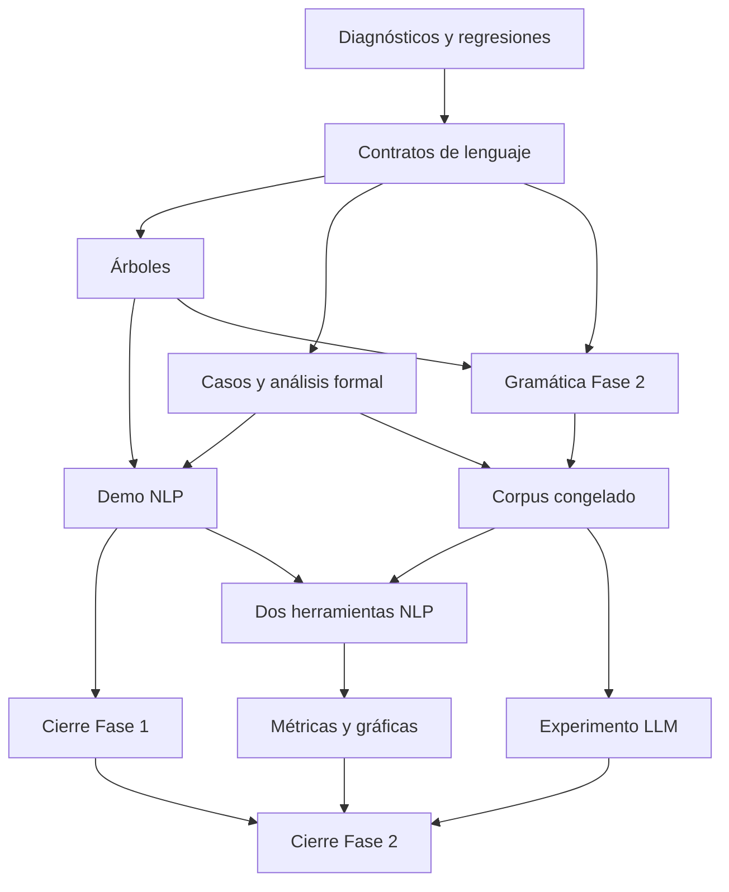

# Plan de implementación y cierre — TLP02-2026

**Fecha de preparación:** 6 de noviembre de 2026, America/El_Salvador.
**Versión base del repositorio:** `c2dcd47f3d173a148cf3ecc9d9c2a68c13983bc3`.
**Estado del documento:** ejecución local realizada; revisión del grupo y API LLM pendientes.
**Objetivo:** completar los requisitos verificables de las fases 1 y 2 con código, pruebas, experimentos y entregables respaldados por evidencia.

La planificación parte de la especificación oficial facilitada por el usuario y de la auditoría del 5 de noviembre. Los pesos y porcentajes de aquella auditoría sirven como línea base del diagnóstico. El avance del plan se registra por criterios de aceptación y evidencias entregadas.

- [Especificación oficial](C:/Users/Cristopher-Diaz-TDW/Downloads/especificaci_n_de_proyecto_tlp02_2026.md)
- [Diagnóstico vigente](C:/Users/Cristopher-Diaz-TDW/Desktop/PROJECTS/TLP-PROYECTO/AUDITORIA_ESTADO_ACTUAL.md)
- [Matriz de 44 requisitos](C:/Users/Cristopher-Diaz-TDW/Desktop/PROJECTS/TLP-PROYECTO/auditoria/2026-11-05/matriz_cumplimiento.json)

## 1. Alcance y decisiones de diseño

Se reutilizan el cálculo FIRST/FOLLOW, la tabla LL(1), el parser con pila, el lexicón y los fixtures existentes. Los cambios al motor se mantienen acotados a contratos, selección de lenguaje, diagnósticos y construcción/presentación del árbol. La infraestructura experimental consume resultados del parser y de herramientas externas.

La implementación conserva la interfaz pública `parse(source, grammar, spanish=False)` para los argumentos existentes y su retorno `(tree, errors)`. Los datos detallados para experimentos se incorporan mediante una extensión compatible. La política de mensajes y el comportamiento de errores se documentan junto con las regresiones que motivan el cambio.

Decisiones propuestas para comenzar:

| Tema | Propuesta inicial | Verificación requerida |
|---|---|---|
| Entrada del español | Validación desde `Oracion`, con configuración consistente de raíz y conjuntos de la gramática. | Vacío y MiniC rechazados como frases, español válido aceptado. |
| MiniC | Fragmentos sintácticos del subconjunto documentado y léxico compatible con las restricciones elegidas de C. | Regresiones actuales, reservadas y literales. |
| Literales MiniC | Preservar texto original. Propuesta de aceptar decimal ASCII `0` o `[1-9][0-9]*` y excluir literales con cero inicial. | Confirmar la política contra el subconjunto documentado y actualizar pruebas/README. |
| Tiempos del español | Presente y pretérito perfecto simple. | Formas singular/plural y concordancia con objetos y modificadores. |
| Corpus | Mínimo 60 frases. Propuesta de 20 simples, 20 intermedias y 20 complejas. | Revisión humana del oro y validación automática de metadatos. |
| Resultados | JSON/JSONL para trazabilidad y exportaciones para tablas/gráficas. | Datos de origen suficientes para regenerar cada figura y métrica. |
| Herramientas NLP | Elegir dos herramientas con análisis del español y tareas comparables. | Fijar biblioteca, modelo, versión, instalación y contrato de evaluación antes del experimento. |
| LLM | Un proveedor vía API, configuración registrada y dos variantes de prompt. | Disponibilidad de clave, modelo y presupuesto definidos antes de ejecutar llamadas. |

La selección de herramientas/modelos y la política final de valencia y adjunción de PP quedan registradas como decisiones de implementación en T05/T07/T09. Los ejemplos anteriores de diseño son propuestas del plan. Las fechas oficiales de entregas son el 2 de noviembre para Fase 1 y el 17 de noviembre para Fase 2. El responsable académico debe gestionar la situación de entrega de la primera fase.

## 2. Línea base verificable

| Elemento | Estado al iniciar |
|---|---|
| Revisión | `c2dcd47`. |
| Pruebas originales | 20 MiniC + 19 español, todas aprobadas en la auditoría. |
| Gramática | 53 no terminales, 102 alternativas y 177 celdas LL(1). |
| Lexicón español | 161 palabras, 19 categorías. |
| Corpus español | 19 oraciones, faltan al menos 41 para el mínimo. |
| Cobertura de líneas | 80,38% del producto con ambas suites originales. |
| Cobertura CLI original | 0%. |
| Regresión de auditoría | 19 expectativas incumplidas en las 90 sondas previas. |
| Experimentos NLP/LLM | Pendientes de implementación. |
| Documentos exigidos | Informes y presentaciones pendientes de localizar o elaborar. |

Los resultados históricos permanecen como evidencia de la revisión auditada. Cada bloque deberá generar resultados nuevos identificados por commit y versión de datos.

## 3. Backlog con dependencias

“Bloqueante” expresa que el componente es necesario para cerrar el entregable de su fase. Los estados reflejan la ejecución local. El cierre académico se verifica con el grupo y el experimento API mantiene la postergación indicada por el usuario.

| ID | Alcance | Prioridad | Trabajo | Dependencias | Estado |
|---|---|---|---|---|---|
| T01 | Base | Alta | Diagnósticos y fallos controlados | Inicio | Verificado en código |
| T02 | Base | Alta | Contrato de cada lenguaje y léxico MiniC | T01 | Verificado en código |
| T03 | Compartida | Alta | Árboles y pruebas estructurales | T01, T02 | Verificado en código |
| T04 | Fase 1 | Bloqueante | Dataset de fallos y evidencia formal de Fase 1 | T01, T02 | Análisis y datos para revisión |
| T05 | Fase 1 | Bloqueante | Primer adaptador NLP y demo comparativa | T03, T04 | Ejecutado con NLP real |
| T06 | Fase 1 | Bloqueante | Entregables y cierre de Fase 1 | T03, T04, T05 | Artefactos preparados, revisión pendiente |
| T07 | Fase 2 | Bloqueante | Gramática española mínima de Fase 2 | T02, T03 | Verificado en código |
| T08 | Fase 2 | Bloqueante | Corpus experimental versionado | T04, T07 | Corpus preparado, revisión humana pendiente |
| T09 | Fase 2 | Bloqueante | Dos herramientas NLP y orquestador común | T05, T07, T08 | Ejecutado con NLP real |
| T10 | Fase 2 | Bloqueante | Métricas, clasificación de errores y gráficas | T08, T09 | Métricas y gráficas verificadas |
| T11 | Fase 2 | Bloqueante | Experimento LLM con reglas y validación | T07, T08 | Integración lista, API pendiente acordada |
| T12 | Fase 2 | Bloqueante | Resultados finales, reproducibilidad y defensa | T06, T07, T08, T09, T10, T11 | Paquete preparado, cierre externo pendiente |

### Orden de ejecución



El orden recomendado es T01–T06 para cerrar la primera fase, seguido de T07–T12. Las dependencias permiten avanzar T07 una vez estabilizados los contratos compartidos. Los experimentos se ejecutan después de congelar la gramática, el corpus y los criterios de evaluación. Los cambios posteriores a esas versiones requieren identificar qué resultados deben regenerarse.

## 4. Especificación de cada bloque

### T01 · Diagnósticos y fallos controlados

**Archivos previstos:** `minic/lexer.py, minic/parser.py, minic/grammar.py, main.py, tests/`.

Conservar posición absoluta, línea y columna de los errores. Emitir los diagnósticos en orden del fuente. Validar gramática vacía, epsilon, símbolos y producciones. Manejar E/S, UTF-8, límites numéricos y códigos de salida. Incorporar pruebas que reproduzcan las causas confirmadas.

**Criterio de aceptación:** El carácter @ en «int x = @1;» se ubica en línea 1, columna 9. El caso mixto de líneas 1 y 2 informa primero el error de línea 1. Archivos ausentes, gramática vacía y número de 5.000 dígitos producen diagnósticos controlados. FIRST/FOLLOW y conflictos se verifican contra oráculos pequeños.

### T02 · Contrato de cada lenguaje y léxico MiniC

**Archivos previstos:** `minic/lexer.py, minic/parser.py, minic/grammar.py, gramatica_minic.txt, README.md, tests/`.

Seleccionar la entrada Oracion para el análisis español y la entrada formal correspondiente para MiniC. Asegurar coherencia entre raíz, FIRST/FOLLOW y tabla. Conservar lexemas de números y posiciones. Rechazar palabras clave de C usadas como identificadores. Documentar MiniC como fragmentos sintácticos del subconjunto acordado.

**Criterio de aceptación:** --es rechaza vacío, comentario aislado y código MiniC. Los 39 fixtures mantienen su resultado esperado. return/float/do/switch se rechazan como nombres. La política numérica define exactamente el tratamiento de 08, 010 y dígitos Unicode. La forma original de los tokens aceptados se conserva.

### T03 · Árboles y pruebas estructurales

**Archivos previstos:** `minic/parser.py, main.py, tests/, módulo de visualización por incorporar`.

Hacer tolerante a profundidad la serialización textual y ofrecer una salida visual exportable para las oraciones del corpus. Añadir aserciones de precedencia, hojas, subordinación y adjunción de frases preposicionales.

**Criterio de aceptación:** Una fuente de 1.200 declaraciones se analiza y serializa sin traceback dentro de los límites publicados. Los árboles del corpus se pueden visualizar. Una subordinada de dos niveles tiene tres nodos Oracion. El test de PP comprueba la adjunción acordada.

### T04 · Dataset de fallos y evidencia formal de Fase 1

**Archivos previstos:** `datos/fase1.json, experimentos/registro_fallos.py, docs/analisis_formal.md, tests/ (rutas propuestas)`.

Definir casos identificados que cubran concordancia, subordinación, modificadores, vocabulario y fenómenos fuera del subconjunto. Registrar tokens, producción/no terminal, posición, fenómeno y clasificación del fallo. Relacionar las conclusiones con la jerarquía de Chomsky mediante argumentos y fuentes.

**Criterio de aceptación:** Cada caso tiene esperado y fenómeno revisados. La salida permite rastrear el fallo hasta una regla o ausencia de regla. El análisis diferencia alcance léxico, diseño de la CFG, restricciones LL(1) y afirmaciones formales sobre familias de lenguajes.

### T05 · Primer adaptador NLP y demo comparativa

**Archivos previstos:** `experimentos/adaptadores/, experimentos/demo_fase1.py, resultados/fase1/ (rutas propuestas)`.

Seleccionar una herramienta con análisis del español y registrar biblioteca, modelo y versión. Ejecutarla junto al parser propio sobre los mismos IDs. Guardar salidas originales, salidas normalizadas y errores.

**Criterio de aceptación:** Un comando ejecuta ambos sistemas sobre datos/fase1.json. La tabla y los árboles se relacionan por ID. Una falla de modelo o dependencia queda registrada como error de ejecución. Se conservan resultados reales de la biblioteca seleccionada.

### T06 · Entregables y cierre de Fase 1

**Archivos previstos:** `docs/informe_fase1.*, docs/presentacion_fase1.*, README.md (rutas propuestas)`.

Producir el informe técnico, actualizar la guía de ejecución y preparar la presentación con demostración. Congelar la gramática y el conjunto usados en los experimentos de esta fase.

**Criterio de aceptación:** Informe de 5–7 páginas con teoría, gramática, intentos sobre español, fallos y comparación. Presentación de 15–20 minutos ensayada. Una instalación limpia puede reproducir código, datos y resultados. Los integrantes revisan la explicación del código y se verifica la entrega/compartición.

### T07 · Gramática española mínima de Fase 2

**Archivos previstos:** `gramatica_minic.txt, minic/lexicon_es.py, minic/lexer.py, tests/es/, README.md`.

Añadir objeto directo nominal y un segundo tiempo verbal. Propuesta inicial de presente y pretérito perfecto simple. Definir complementos de los verbos del vocabulario, concordancia y adjunción de PP. Factorizar producciones cuando sea necesario para conservar LL(1).

**Criterio de aceptación:** Se aceptan SVO singular/plural en ambos tiempos y se rechazan discordancias. Adjetivos, adverbios, PP y subordinadas siguen operativos. La tabla se construye sin conflictos y los árboles verifican sujeto, verbo y objeto. Se documentan vocabulario y límites.

### T08 · Corpus experimental versionado

**Archivos previstos:** `datos/corpus_es.json, datos/ejemplos_few_shot.json, experimentos/validar_corpus.py, tests/ (rutas propuestas)`.

Construir al menos 60 frases con tres niveles, IDs únicos, fenómenos y salidas esperadas. Propuesta de 20 por nivel. Separar ejemplos de demostración/few-shot del conjunto evaluado y registrar la versión de gramática a la que corresponden las etiquetas.

**Criterio de aceptación:** Validador comprueba tamaño >=60, tres niveles, IDs, campos y ausencia de duplicados entre evaluación y ejemplos. Revisión humana de etiquetas de pertenencia al subconjunto, corrección general y estructuras requeridas. Al menos 41 frases adicionales quedan incorporadas frente a la base de 19.

### T09 · Dos herramientas NLP y orquestador común

**Archivos previstos:** `experimentos/adaptadores/, experimentos/comparar_nlp.py, resultados/nlp/ (rutas propuestas)`.

Incorporar una segunda herramienta y definir tareas comparables según sus salidas disponibles. Ejecutar parser y ambas herramientas sobre todos los IDs. Guardar modelos, versiones, parámetros, tiempos y errores con un contrato común.

**Criterio de aceptación:** Resultados completos de las tres implementaciones para el mismo corpus. Cada métrica tiene tarea, etiquetas y criterio de decisión documentados. Se conserva la salida original de cada herramienta. El éxito técnico del procesamiento se distingue de las decisiones lingüísticas evaluadas.

### T10 · Métricas, clasificación de errores y gráficas

**Archivos previstos:** `experimentos/metricas.py, experimentos/graficas.py, resultados/metricas/, tests/ (rutas propuestas)`.

Calcular precisión, recall, rechazo correcto y clasificación de errores por sistema y nivel para las tareas comparables. Generar tablas y gráficas desde resultados persistidos.

**Criterio de aceptación:** Cálculos contrastados con un ejemplo pequeño de TP/FP/TN/FN conocido. Denominadores cero y datos faltantes tienen política explícita. Se distinguen errores de etiquetado y ejecución. Las tablas/gráficas pueden regenerarse a partir de resultados guardados.

### T11 · Experimento LLM con reglas y validación

**Archivos previstos:** `experimentos/llm.py, experimentos/validar_derivacion.py, prompts/, resultados/llm/, tests/ (rutas propuestas)`.

Integrar un proveedor vía API, generar prompts con reglas explícitas y variantes zero-shot/few-shot. Solicitar respuesta estructurada y validar decisiones, producciones, hojas y derivación frente a la gramática registrada. Guardar solicitudes, respuestas, parámetros y errores.

**Criterio de aceptación:** Las mismas frases se evalúan bajo ambas variantes con configuración registrada. Ejemplos few-shot separados del corpus evaluado. Logs contienen respuestas reales y hashes de gramática/corpus/prompts. Se reportan desviaciones de reglas y aciertos/fallos, incluso cuando few-shot no mejora. La ejecución admite reanudación sin duplicar llamadas completadas.

### T12 · Resultados finales, reproducibilidad y defensa

**Archivos previstos:** `experimentos/, resultados/, docs/informe_fase2.*, docs/presentacion_fase2.*, README.md, requirements y configuración de pruebas (rutas propuestas)`.

Integrar resultados NLP/LLM, análisis de robustez y ambigüedad, mediciones de tiempo/costo y discusión de escalabilidad. Preparar informe, presentación, instalación reproducible y reevaluación de los 44 requisitos.

**Criterio de aceptación:** Informe de 7–10 páginas sustentado por datos reales. Presentación de 15–20 minutos con demo ensayada. Instalación limpia y pruebas en Python mínimo anunciado y versión de trabajo. Dependencias/modelos identificados. Cada uno de los 44 requisitos cuenta con evidencia revisable y se verifica la entrega académica.


## 5. Datos y contratos experimentales

Las rutas de esta sección son propuestas de implementación. Cada dato de evaluación debe tener una procedencia revisable.

### Registro del corpus

```json
{
  "id": "ES-001",
  "texto": "El niño lee el libro",
  "nivel": "simple",
  "fenomenos": ["SVO", "presente", "concordancia"],
  "esperado_cfg": true,
  "gramatical_espanol": true,
  "grammar_version": "identificador-de-gramatica",
  "estructura_esperada": {
    "sujeto": "El niño",
    "verbo": "lee",
    "objeto": "el libro"
  }
}
```

`esperado_cfg` representa pertenencia al subconjunto definido. `gramatical_espanol` es una etiqueta separada de corrección general y admite valor no determinado si el caso requiere revisión. Las salidas de POS/dependencias se evalúan con oro compatible cuando formen parte de las tareas elegidas.

Cada oración se etiqueta antes de observar las predicciones de los sistemas. Los ejemplos usados para few-shot tienen IDs y archivo propios y quedan separados del conjunto evaluado.

### Registro de ejecución

Como mínimo se conservan:

- ID de ejecución y de oración.
- Commit, hash/versión de gramática y corpus.
- Herramienta, modelo, versión y configuración.
- Tarea evaluada, decisión o etiquetas predichas.
- Salida original y salida normalizada.
- Diagnósticos o error de ejecución.
- Duración por oración y contexto de medición.
- Para LLM, variante, hash del prompt, respuesta, uso de tokens y costo cuando estén disponibles.

Las claves de acceso se obtienen del entorno y quedan excluidas de los archivos de resultados. Los fallos de red, dependencia o modelo se registran separados de los errores lingüísticos. Las ejecuciones reanudables identifican resultados ya completos para evitar duplicación y consumo innecesario.

### Métricas y evaluación

| Resultado | Regla de cálculo o validación |
|---|---|
| Precisión | TP / (TP + FP), con clase positiva y tarea definidas. |
| Recall | TP / (TP + FN). |
| Rechazo correcto | TN / (TN + FP). |
| Etiquetado | Comparación de las etiquetas seleccionadas contra oro compatible. |
| Adhesión del LLM | Producciones existentes, raíz correcta, hojas compatibles con la entrada y derivación completa. |
| Robustez | Resultados de entradas fuera del vocabulario, discordancias y variaciones controladas. |
| Ambigüedad | Casos documentados con interpretaciones/estructuras esperadas y limitaciones de cada sistema. |
| Escalabilidad | Mediciones por longitud/complejidad y condiciones de ejecución registradas. |
| Costo | Tokens/consumo disponible, tiempo y recursos observables, con supuestos explícitos. |

Si el denominador de una métrica es cero, se registra como indefinida con su causa. Se informa cuántas entradas contribuyen a cada indicador y cuáles quedaron con error de ejecución o datos faltantes.

Para herramientas NLP que entregan etiquetas o dependencias, el contrato debe definir una tarea realmente comparable. La generación de una estructura por sí sola acredita procesamiento. La decisión de pertenencia a la CFG requiere un criterio adicional explícito y revisado.

## 6. Organización propuesta del código y las evidencias

```text
minic/                         motor, lexer y lexicón existentes
gramatica_minic.txt             gramática versionada
main.py                        CLI del parser y visualización
tests/                         regresiones y contratos verificables
datos/
  fase1.json                   casos de demo y fenómenos de Fase 1
  corpus_es.json               conjunto evaluado de Fase 2
  ejemplos_few_shot.json        ejemplos separados de evaluación
experimentos/
  registro_fallos.py            trazabilidad de casos y reglas
  demo_fase1.py                 parser propio y primer analizador NLP
  adaptadores/                 integraciones de herramientas seleccionadas
  validar_corpus.py            validación de metadatos y separación de datos
  comparar_nlp.py               ejecución homogénea del corpus
  metricas.py                  métricas a partir de resultados guardados
  graficas.py                  figuras/tablas del experimento
  llm.py                       ejecución vía API y registro
  validar_derivacion.py         comprobación de reglas/árboles del LLM
prompts/                       plantillas zero-shot y few-shot
resultados/                    salidas originales, métricas y figuras
docs/                          informes, análisis formal y presentaciones
README.md                      instalación y reproducción
```

Se incorporan módulos conforme a las tareas que los usan. La elección concreta de bibliotecas y los ajustes de nombres se documentan durante la implementación.

## 7. Estrategia de verificación

| Nivel | Verificación necesaria |
|---|---|
| Regresión existente | Los 39 fixtures conservan sus resultados esperados. |
| Lexer | Reservadas, lexemas numéricos, posiciones, mayúsculas/acentos y separación de modos. |
| Gramática | Oráculos pequeños de FIRST/FOLLOW, nulabilidad, conflictos y configuraciones inválidas. |
| Parser | Aceptación, rechazo, recuperación y estructura del árbol. |
| Español | SVO, dos tiempos, concordancia, subordinadas y modificadores con positivos/negativos. |
| CLI | Fuente válida/inválida, errores de E/S/configuración y salida visual/textual. |
| Corpus | Tamaño mínimo, niveles, campos, IDs y separación entre evaluación y ejemplos. |
| Métricas | Matriz de confusión conocida, denominadores cero, faltantes y errores de ejecución. |
| Adaptadores | Contrato de salida y ejecución real documentada con los modelos seleccionados. |
| LLM | Validación de respuesta estructurada y de reglas, además de resultados reales de API. |
| Reproducibilidad | Instalación limpia, modelos/versiones, comandos y regeneración de tablas/gráficas. |

Las pruebas nuevas se añaden para los defectos confirmados y los contratos experimentales introducidos. La evidencia de integraciones se obtiene también mediante ejecuciones reales identificadas y guardadas.

## 8. Puertas de cierre y definición de terminado

| Puerta | Evidencia necesaria |
|---|---|
| G0 · Base técnica | T01–T03 aceptados, regresiones y CLI verificadas. |
| G1 · Fase 1 | T04–T06 aceptados, demo comparativa real, análisis formal, informe y presentación revisados. |
| G2 · Datos de Fase 2 | T07–T08 aceptados, gramática/corpus congelados y etiquetas revisadas. |
| G3 · Experimentos | T09–T11 aceptados, dos herramientas NLP, métricas y llamadas LLM con salidas reales trazables. |
| G4 · Fase 2 | T12 aceptado, informe final, gráficas, presentación, reproducción y revisión de requisitos. |

Un bloque se marca **Completado** cuando el código pasa por sus entradas normales, cumple los casos positivos y negativos definidos, dispone de evidencia y tiene su documentación de uso actualizada. Si depende de una herramienta o servicio externo, su ejecución real forma parte del cierre.

La matriz de cumplimiento se actualiza a partir de las evidencias nuevas. Para declarar cierre de ambas fases se revisan los 44 requisitos y los entregables académicos de presentación/compartición que requieren participación del grupo.

## 9. Trazabilidad de los 44 requisitos

| Requisito auditado | Bloques que lo completan o verifican | Evidencia exigida |
|---|---|---|
| F1-REQ-01 | T01, T02 | Criterios de los bloques asociados, pruebas/resultados y evidencia documental que corresponda. |
| F1-REQ-02 | T03 | Criterios de los bloques asociados, pruebas/resultados y evidencia documental que corresponda. |
| F1-REQ-03 | T01 | Criterios de los bloques asociados, pruebas/resultados y evidencia documental que corresponda. |
| F1-REQ-04 | T01, T02, T03 | Criterios de los bloques asociados, pruebas/resultados y evidencia documental que corresponda. |
| F1-REQ-05 | T02, T04 | Criterios de los bloques asociados, pruebas/resultados y evidencia documental que corresponda. |
| F1-REQ-06 | T04, T07 | Criterios de los bloques asociados, pruebas/resultados y evidencia documental que corresponda. |
| F1-REQ-07 | T04, T07 | Criterios de los bloques asociados, pruebas/resultados y evidencia documental que corresponda. |
| F1-REQ-08 | T03, T04 | Criterios de los bloques asociados, pruebas/resultados y evidencia documental que corresponda. |
| F1-REQ-09 | T04, T07 | Criterios de los bloques asociados, pruebas/resultados y evidencia documental que corresponda. |
| F1-REQ-10 | T04, T07 | Criterios de los bloques asociados, pruebas/resultados y evidencia documental que corresponda. |
| F1-REQ-11 | T03, T07 | Criterios de los bloques asociados, pruebas/resultados y evidencia documental que corresponda. |
| F1-REQ-12 | T04 | Criterios de los bloques asociados, pruebas/resultados y evidencia documental que corresponda. |
| F1-REQ-13 | T04, T06 | Criterios de los bloques asociados, pruebas/resultados y evidencia documental que corresponda. |
| F1-REQ-14 | T05 | Criterios de los bloques asociados, pruebas/resultados y evidencia documental que corresponda. |
| F1-REQ-15 | T06, T12 | Criterios de los bloques asociados, pruebas/resultados y evidencia documental que corresponda. |
| F1-REQ-16 | T06 | Criterios de los bloques asociados, pruebas/resultados y evidencia documental que corresponda. |
| F2-REQ-01 | T07 | Criterios de los bloques asociados, pruebas/resultados y evidencia documental que corresponda. |
| F2-REQ-02 | T07 | Criterios de los bloques asociados, pruebas/resultados y evidencia documental que corresponda. |
| F2-REQ-03 | T07, T08 | Criterios de los bloques asociados, pruebas/resultados y evidencia documental que corresponda. |
| F2-REQ-04 | T07, T08 | Criterios de los bloques asociados, pruebas/resultados y evidencia documental que corresponda. |
| F2-REQ-05 | T03, T07, T08 | Criterios de los bloques asociados, pruebas/resultados y evidencia documental que corresponda. |
| F2-REQ-06 | T07 | Criterios de los bloques asociados, pruebas/resultados y evidencia documental que corresponda. |
| F2-REQ-07 | T07, T08 | Criterios de los bloques asociados, pruebas/resultados y evidencia documental que corresponda. |
| F2-REQ-08 | T07, T08 | Criterios de los bloques asociados, pruebas/resultados y evidencia documental que corresponda. |
| F2-REQ-09 | T02, T07 | Criterios de los bloques asociados, pruebas/resultados y evidencia documental que corresponda. |
| F2-REQ-10 | T03 | Criterios de los bloques asociados, pruebas/resultados y evidencia documental que corresponda. |
| F2-REQ-11 | T08 | Criterios de los bloques asociados, pruebas/resultados y evidencia documental que corresponda. |
| F2-REQ-12 | T08 | Criterios de los bloques asociados, pruebas/resultados y evidencia documental que corresponda. |
| F2-REQ-13 | T08 | Criterios de los bloques asociados, pruebas/resultados y evidencia documental que corresponda. |
| F2-REQ-14 | T09 | Criterios de los bloques asociados, pruebas/resultados y evidencia documental que corresponda. |
| F2-REQ-15 | T09 | Criterios de los bloques asociados, pruebas/resultados y evidencia documental que corresponda. |
| F2-REQ-16 | T10 | Criterios de los bloques asociados, pruebas/resultados y evidencia documental que corresponda. |
| F2-REQ-17 | T10 | Criterios de los bloques asociados, pruebas/resultados y evidencia documental que corresponda. |
| F2-REQ-18 | T10 | Criterios de los bloques asociados, pruebas/resultados y evidencia documental que corresponda. |
| F2-REQ-19 | T10 | Criterios de los bloques asociados, pruebas/resultados y evidencia documental que corresponda. |
| F2-REQ-20 | T10 | Criterios de los bloques asociados, pruebas/resultados y evidencia documental que corresponda. |
| F2-REQ-21 | T11 | Criterios de los bloques asociados, pruebas/resultados y evidencia documental que corresponda. |
| F2-REQ-22 | T11 | Criterios de los bloques asociados, pruebas/resultados y evidencia documental que corresponda. |
| F2-REQ-23 | T11 | Criterios de los bloques asociados, pruebas/resultados y evidencia documental que corresponda. |
| F2-REQ-24 | T11 | Criterios de los bloques asociados, pruebas/resultados y evidencia documental que corresponda. |
| F2-REQ-25 | T11 | Criterios de los bloques asociados, pruebas/resultados y evidencia documental que corresponda. |
| F2-REQ-26 | T12 | Criterios de los bloques asociados, pruebas/resultados y evidencia documental que corresponda. |
| F2-REQ-27 | T12 | Criterios de los bloques asociados, pruebas/resultados y evidencia documental que corresponda. |
| F2-REQ-28 | T12 | Criterios de los bloques asociados, pruebas/resultados y evidencia documental que corresponda. |

La trazabilidad cubre tanto los requisitos pendientes como la verificación de los que ya disponen de implementación funcional.

## 10. Dependencias externas y decisiones por resolver

| Dependencia | Momento necesario | Resultado que debe quedar registrado |
|---|---|---|
| Selección de primer analizador español | T05 | Biblioteca/modelo/versiones y ejemplo real de salida. |
| Segundo analizador y tareas comparables | T09 | Justificación de comparación y contrato de etiquetas/decisiones. |
| Proveedor, modelo, clave y presupuesto LLM | T11 | Configuración de ejecución y límites del experimento. |
| Revisión humana del corpus y teoría | T04/T08/T12 | Etiquetas validadas, argumentos formales y discusión de resultados. |
| Datos de integrantes y formato académico | T06/T12 | Autoría, informes y presentaciones adecuados a la entrega. |
| Entrega y exposición ante el docente | G1/G4 | Verificación del grupo sobre compartición, envío y ensayo/exposición. |

Las tareas de desarrollo local avanzan de acuerdo con sus dependencias. Las decisiones externas se resuelven antes de ejecutar el componente que las necesita.

## 11. Seguimiento de implementación

Para cada Txx se registra la revisión de inicio/cierre, cambios, pruebas ejecutadas, evidencia producida y criterios aún abiertos. Las revisiones se mantienen pequeñas y vinculadas a uno o varios bloques concretos.

La primera unidad de implementación es **T01, diagnósticos y fallos controlados**, seguida de **T02, contratos de cada lenguaje y léxico MiniC**. El avance se comprueba mediante regresiones específicas y las suites existentes antes de continuar con árboles y experimentos.


## 12. Ejecución realizada

Se ejecutaron los bloques locales. El estado detallado y los pendientes del grupo están en docs/ESTADO_IMPLEMENTACION.md. La ejecución API del LLM queda pendiente por indicación expresa del usuario.
